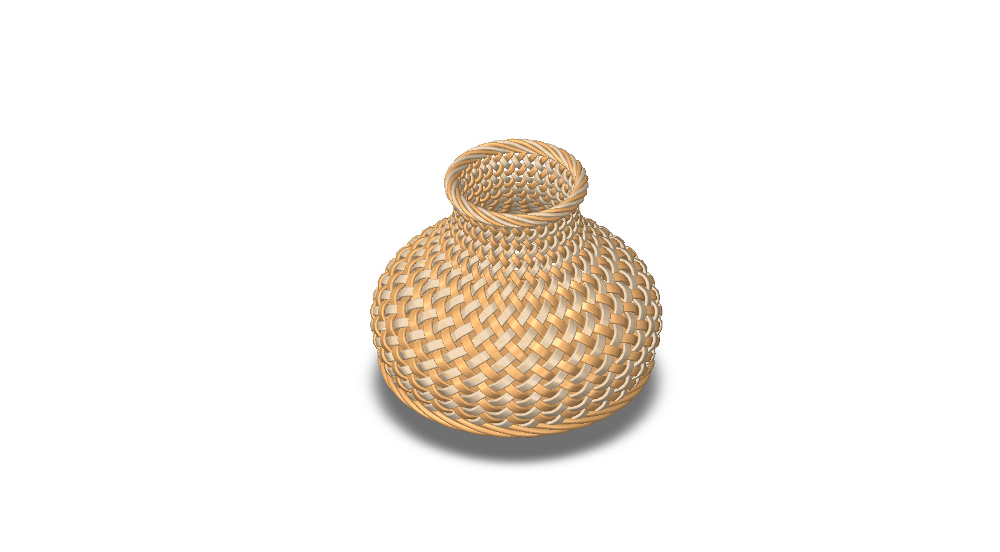
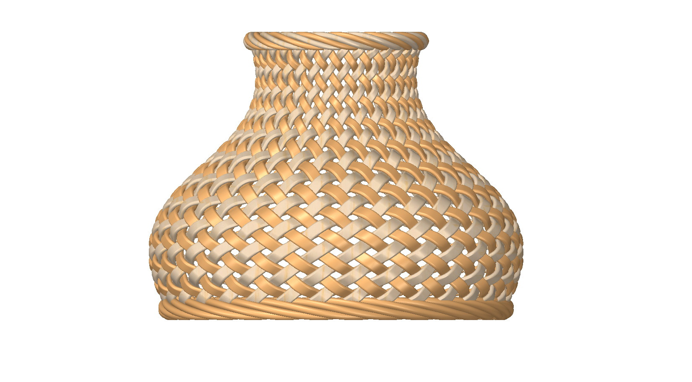
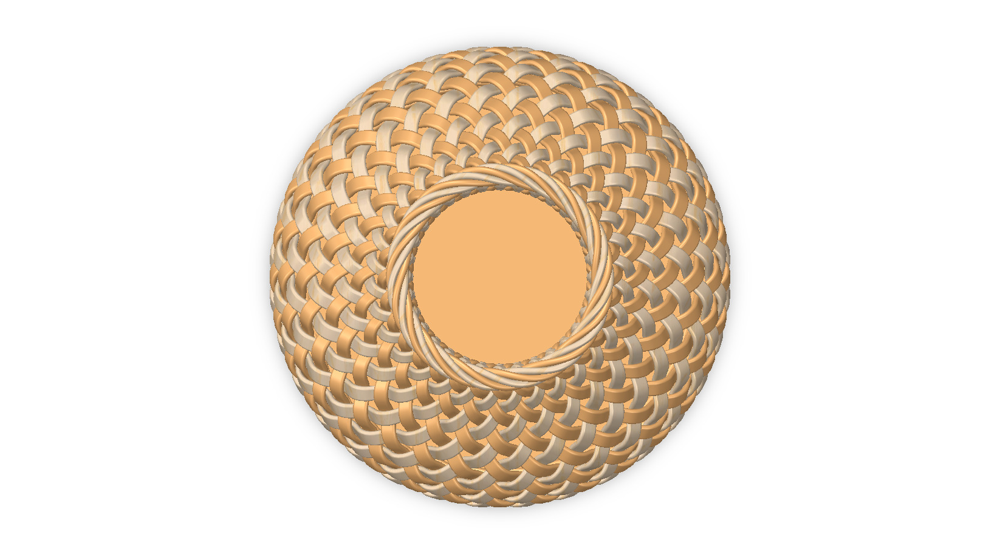
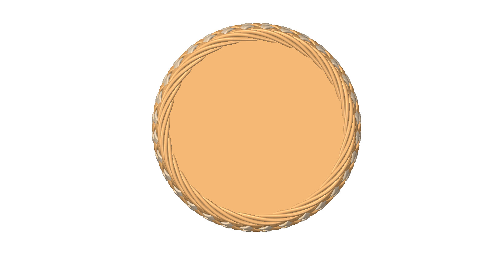
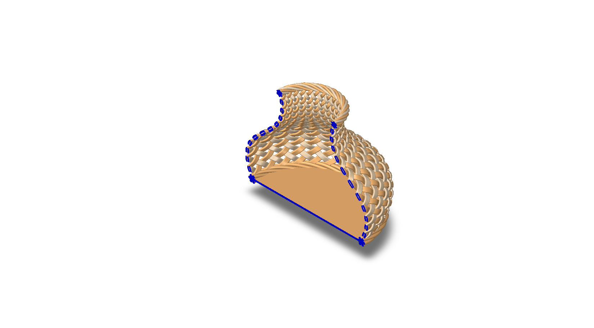
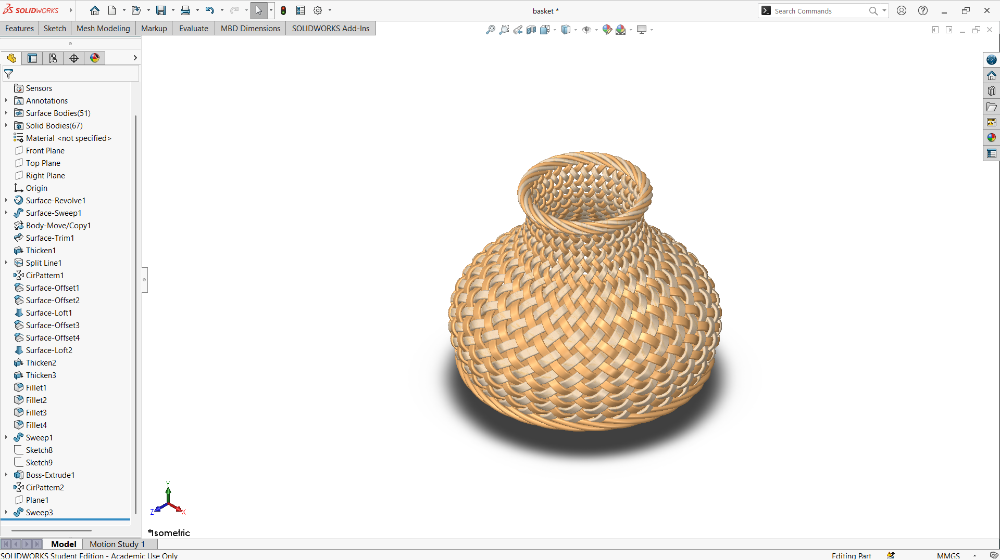

# Concept Design Prototype of a Euplectella aspergillum-Inspired Flower Basket

## Summary

Ocean has been a curious center for human beings from very ancient times. The deep ocean floor, especially abyssal zones up to 5,000 meters deep, presents an environment where nature turns into engineering. From the inspiration of the deep ocean sponge, _Euplectella aspergillum_ [^1], an innovative basket design prototype has been developed by using a computational tool.

|                 Name                 |                                         Image                                          |
| :----------------------------------: | :------------------------------------------------------------------------------------: |
|     Euplectella Aspergillum [^2]     |                  |
| Euplectella Aspergillum Ekeanos [^3] |  |

---

## Computational Design

|   View    |                        Image                        |
| :-------: | :-------------------------------------------------: |
| Isometric |  |
|   Left    |            |
|   Right   |          |
|   Back    |            |
|   Front   |          |
|    Top    |              |
|  Bottom   |        |
|  Section  |      |

---

## Software Used

| Purpose |               Name                |
| :-----: | :-------------------------------: |
| Design  | SolidWorks 2024 (Student Version) |

---

## Tools Used

| No  |      Name       |
| :-: | :-------------: |
| 01  | Surface Revolve |
| 02  |  Surface Sweep  |
| 03  | Body Move/Copy  |
| 04  |  Surface Trim   |
| 05  |     Thicken     |
| 06  |   Split Line    |
| 07  |   CirPattern    |
| 08  | Surface Offset  |
| 09  |  Surface Loft   |
| 10  |     Fillet      |
| 11  |      Sweep      |
| 12  |     Sketch      |
| 13  |  Boss Extrude   |

---

## Feature Tree

---

## Applications [^4]

- Gift Basket
- Rattan Basket Vase
- Indoor Plant Holder
- Dresser Decor + Storage
- Side Table Decor + Storage
- Decorating with Baskets on the Wall

---

## Design Limitations

The design of the basket was developed as a prototype product. That’s why the real-life design considerations, including usability, accessibility, lifecycle analysis, material selection, proper design specification, monetization, and feasibility, have not been included.

---

## Future Improvements

There is a lot of room for improvement. Firstly, the computational design process of the basket was developed using the manual processing available in software, which took a lot of time. So, if any mistakes happen during the design process, it is very difficult to figure out why and where the mistake happened. Also, proper engineering analysis, including computational analysis and experimental testing, including real-life scenarios, should be considered in the future to convert this prototype into a real product.

---

## Acknowledgements

Special thanks to the [EasyCAD Solutions](https://www.youtube.com/@EasyCADSolutions) YouTube channel for the SolidWorks tutorials that helped in creating this design.

---

## References

[^1]: [Venus' flower basket](https://en.wikipedia.org/wiki/Venus%27_flower_basket)

[^2]: [Top of a A Venus flower basket sponge - Euplectella aspergillum](<https://en.wikipedia.org/wiki/File:Expn4384_(27840605922).jpg>)

[^3]: [A spectacular group of Venus flower basket glass sponges (Euplectella aspergillum) glass sponges with a squat lobster in the middle](https://en.wikipedia.org/wiki/File:Euplectella_aspergillum_Okeanos.jpg)

[^4]: [16 Uses of Wicker Basket: Storage and Decor Ideas That Wow](https://greenlivinglife.com/blogs/greenlife/uses-of-wicker-basket-storage-and-decor-ideas)
